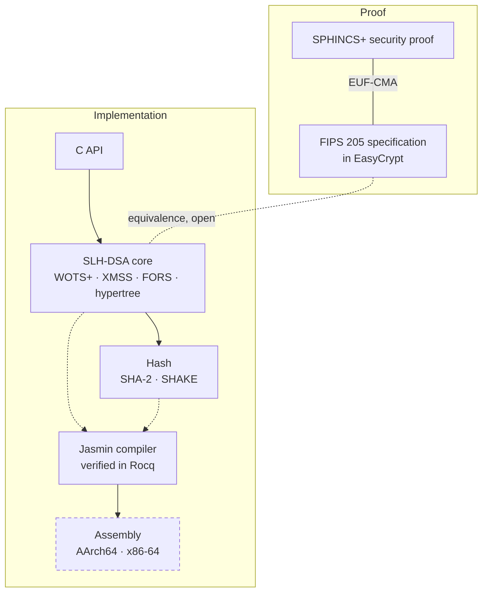

<div align="center">

# nirapod-slhdsa

SLH-DSA (FIPS 205) in [Jasmin](https://github.com/jasmin-lang/jasmin) for AArch64 and x86-64,
with machine-checked proofs in [EasyCrypt](https://github.com/EasyCrypt/easycrypt).

[](https://github.com/nirapod-labs/nirapod-slhdsa/actions/workflows/ci.yml)
[](LICENSE)

</div>

> [!WARNING]
> **Under development. Not for production use.**
> The hash layer, the SLH-DSA core and its C API are on this branch; the proofs are not.
> Nothing below is claimed until its row shows a result, and every result names the
> revision it was validated on.

## Status

Each cell is filled by the change that lands the component, with the CI run that checked
it. A dash means no result yet.

| Parameter set     | Tests, AArch64 | Tests, x86-64 | Constant time | Speculative CT | Memory safety | Proof |
| :---------------- | :------------: | :-----------: | :-----------: | :------------: | :-----------: | :---: |
| `SLH-DSA-SHA2-128s`  | — | — | PASS, `ee70fee` | PASS, `ee70fee` | — | — |
| `SLH-DSA-SHA2-128f`  | — | — | PASS, `ee70fee` | PASS, `ee70fee` | — | — |
| `SLH-DSA-SHA2-192s`  | — | — | PASS, `ee70fee` | PASS, `ee70fee` | — | — |
| `SLH-DSA-SHA2-192f`  | — | — | PASS, `ee70fee` | PASS, `ee70fee` | — | — |
| `SLH-DSA-SHA2-256s`  | — | — | PASS, `ee70fee` | PASS, `ee70fee` | — | — |
| `SLH-DSA-SHA2-256f`  | — | — | PASS, `ee70fee` | PASS, `ee70fee` | — | — |
| `SLH-DSA-SHAKE-128s` | — | — | PASS, `ee70fee` | PASS, `ee70fee` | — | — |
| `SLH-DSA-SHAKE-128f` | — | — | PASS, `ee70fee` | PASS, `ee70fee` | — | — |
| `SLH-DSA-SHAKE-192s` | — | — | PASS, `ee70fee` | PASS, `ee70fee` | — | — |
| `SLH-DSA-SHAKE-192f` | — | — | PASS, `ee70fee` | PASS, `ee70fee` | — | — |
| `SLH-DSA-SHAKE-256s` | — | — | PASS, `ee70fee` | PASS, `ee70fee` | — | — |
| `SLH-DSA-SHAKE-256f` | — | — | PASS, `ee70fee` | PASS, `ee70fee` | — | — |

Tests means NIST ACVP vectors, differential tests against independent implementations,
and negative tests, run natively on that architecture. Per-interface detail is in
[`docs/STATUS.md`](docs/STATUS.md).

## How it fits together



Dashed boxes are not on this branch yet; dotted links are proofs still open. The pinned
compiler, the hash layer, the core, the C API, the EasyCrypt specification of FIPS 205 and
its EUF-CMA proof are here today; the assembly is built from them, not shipped.

## What is proven, and what is not

| Claim | Evidence | Scope |
| :---- | :------- | :---- |
| EUF-CMA security of the FIPS 205 specification | proved in EasyCrypt from the SPHINCS+ proof of ePrint 2024/910; `make -C proofs check` re-checks both | the specification, not the Jasmin code; the specification is checked against FIPS 205 by review and `proofs/spec/validation/`, and has not been run on ACVP vectors; all 12 parameter sets, pure and pre-hash, deterministic and hedged signing; a concrete bound in PRF, ITSR, tweakable-hash and pre-hash collision terms; hypotheses and limits in [`proofs/README.md`](proofs/README.md#security-of-the-specification) |
| The Jasmin implementation is equivalent to the specification | open; one component proved in EasyCrypt on the code `jasmin2ec` extracts | the hash address procedures of `src/slhdsa/address.jinc` compute the address setters of FIPS 205 Table 1, on the x86-64 and AArch64 models, total correctness, for all 12 parameter sets (the code depends on none); no FIPS 205 algorithm is covered yet ([`proofs/README.md`](proofs/README.md#extracted-models-and-correctness-proofs)) |
| Hash primitives match FIPS 180-4 and FIPS 202 | partly proved in EasyCrypt on the code `jasmin2ec` extracts | `_sha256_compress` and `_sha512_compress`, the one-block entry points of the portable SHA-2 kernels, with their round functions, on the x86-64 and AArch64 models, total correctness; not the entry points that read blocks from memory (`_sha*_compress_blocks`, used by the streaming hash), nor the kernels that replace the portable ones: SHA-NI in the x86-64 `shani` variant and the SHA-2 instruction kernels in the AArch64 `sha2` variant (the scalar variant runs the portable SHA-2 kernels on both architectures). The Keccak-f[1600] permutation of the single-way kernels the scalar variants build (the portable kernel on x86-64, the kernel that keeps the state in registers on AArch64), total correctness; not the single-way and four-way kernels on the A64 SHA-3 instructions (AArch64 `sha3` variant), the portable and AVX2 four-way kernels, the sponge, SHA-3 or SHAKE; the rest is open ([`proofs/README.md`](proofs/README.md#extracted-models-and-correctness-proofs)) |
| Constant time and speculative constant time on every secret-dependent path | checked by `jasmin-ct` and `jasmin-ct --sct` on every parameter-set unit (`make ct`, run by CI on both architectures); passes on every unit of both architectures, see the status table | the Jasmin source, under the security types of its exports; conditional on memory safety, which is not checked yet; declassifications argued in [`docs/DECLASSIFICATION.md`](docs/DECLASSIFICATION.md) |
| Memory safety of every export | not run on this branch | — |
| The compiler preserves the semantics of safe programs | proved in Rocq; `toolchain/build.sh` re-checks the proofs | from the Jasmin AST to the assembly semantics, per target; the front end, assembly printer, assembler and linker are outside it; assumptions in [`toolchain/jasmin/ASSUMPTIONS`](toolchain/jasmin/ASSUMPTIONS) |

A claim moves up only with its proof or check in the repository and a CI run that
reproduces it. Each proof's assumptions are listed in the file its row links.

## Building

The toolchain is rebuilt from pinned inputs by one script. From a clean checkout:

```sh
JOBS=4 toolchain/build.sh          # opam switch, Jasmin with its proofs, tests
export PATH="$PWD/toolchain/work/bin:$PATH"
```

Host requirements, pins and the patch series are in [`docs/TOOLCHAIN.md`](docs/TOOLCHAIN.md).
Then the library, its tests and its checks:

```sh
make JASMINC=jasminc               # build/<target>/lib/libnirapod_slhdsa.a
make check JASMINC=jasminc         # the tests of this host
make ct asm-policy JASMINC=jasminc # constant-time checks, emitted-code policies
```

How to call it is described in [`docs/API.md`](docs/API.md).

<details>
<summary><b>Toolchain pins</b></summary>

| Component | Pin |
| :-------- | :-- |
| Jasmin | `jasmin-lang/jasmin` `e8f59794c` plus the series in [`toolchain/jasmin/SERIES`](toolchain/jasmin/SERIES) |
| Rocq | 9.0.1, mathcomp 2.4.0, OCaml 4.14.4 |
| EasyCrypt | `e7eff05d`, Why3 1.8.2 |
| SMT provers | Z3 4.8.17, 4.12.6, 4.13.4, 4.16.0; CVC5 1.0.9, 1.2.1; Alt-Ergo 2.5.4, 2.6.4 |

Every patch has its provenance, purpose, test and upstream status in
[`toolchain/jasmin/PATCHES.md`](toolchain/jasmin/PATCHES.md).

</details>

<details>
<summary><b>Repository layout</b></summary>

```text
include/          the C API: nirapod_slhdsa.h
src/slhdsa/       FIPS 205 in Jasmin: addresses, WOTS+, XMSS, FORS, the hypertree,
                  the internal and external interfaces, one unit per parameter set
src/hash/         SHA-2, SHA-3, SHAKE, HMAC and MGF1 in Jasmin
capi/             the C wrapper: argument checks, variant dispatch, entropy, DIT,
                  clearing; testing/ holds the FIPS 205 internal functions for tests
tests/core/       functional tests and ACVP known answers of the library
tests/negative/   malformed input, overlapping buffers, injected faults, a failing
                  random source
tests/abi/        exported symbols, and the stack and registers a call leaves behind
tests/hash/       CAVP, differential and negative tests of the hash layer
analysis/         constant-time analysis and emitted-code policies of the units
proofs/           EasyCrypt specifications and proofs
third_party/      imported EasyCrypt theories, with their provenance
toolchain/        pinned Jasmin and EasyCrypt, the patch series, build.sh
ci/               CI checks and release tooling
changes/          one entry per change, collected at release
docs/             the C API, declassification, toolchain and status
```

</details>

## Security

Report vulnerabilities privately, as described in [`SECURITY.md`](SECURITY.md).

## License

Apache-2.0. See [`LICENSE`](LICENSE) and [`NOTICE`](NOTICE).
