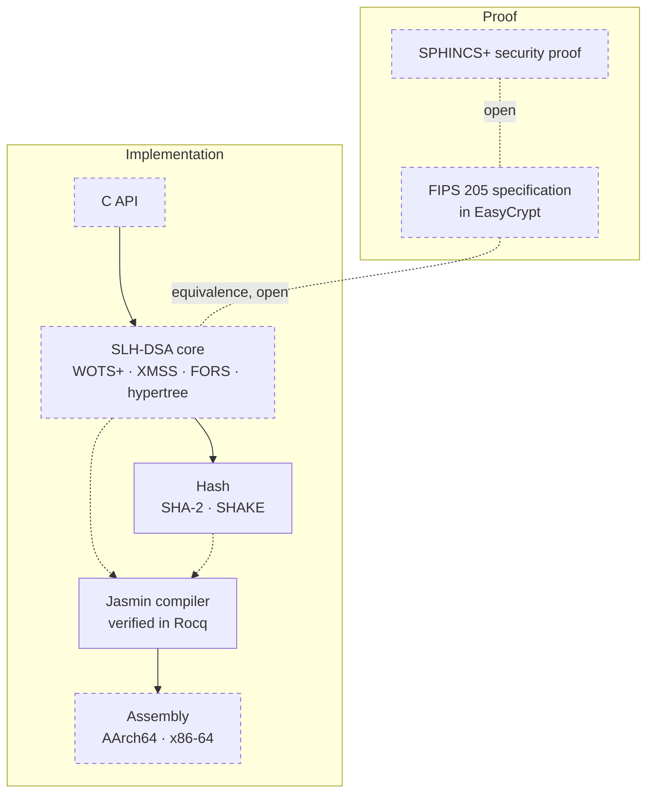

<div align="center">

# nirapod-slhdsa

SLH-DSA (FIPS 205) in [Jasmin](https://github.com/jasmin-lang/jasmin) for AArch64 and x86-64,
with machine-checked proofs in [EasyCrypt](https://github.com/EasyCrypt/easycrypt).

[](https://github.com/nirapod-labs/nirapod-slhdsa/actions/workflows/ci.yml)
[](LICENSE)

</div>

> [!WARNING]
> **Under development. Not for production use.**
> Of the implementation, only the hash layer is on this branch so far. Nothing below is
> claimed until its row shows a result, and every result names the revision it was
> validated on.

## Status

Each cell is filled by the change that lands the component, with the CI run that checked
it. A dash means no result yet.

| Parameter set     | Tests, AArch64 | Tests, x86-64 | Constant time | Speculative CT | Memory safety | Proof |
| :---------------- | :------------: | :-----------: | :-----------: | :------------: | :-----------: | :---: |
| `SLH-DSA-SHA2-128s`  | — | — | — | — | — | — |
| `SLH-DSA-SHA2-128f`  | — | — | — | — | — | — |
| `SLH-DSA-SHA2-192s`  | — | — | — | — | — | — |
| `SLH-DSA-SHA2-192f`  | — | — | — | — | — | — |
| `SLH-DSA-SHA2-256s`  | — | — | — | — | — | — |
| `SLH-DSA-SHA2-256f`  | — | — | — | — | — | — |
| `SLH-DSA-SHAKE-128s` | — | — | — | — | — | — |
| `SLH-DSA-SHAKE-128f` | — | — | — | — | — | — |
| `SLH-DSA-SHAKE-192s` | — | — | — | — | — | — |
| `SLH-DSA-SHAKE-192f` | — | — | — | — | — | — |
| `SLH-DSA-SHAKE-256s` | — | — | — | — | — | — |
| `SLH-DSA-SHAKE-256f` | — | — | — | — | — | — |

Tests means NIST ACVP vectors, differential tests against independent implementations,
and negative tests, run natively on that architecture. Per-interface detail is in
[`docs/STATUS.md`](docs/STATUS.md).

## How it fits together



Dashed boxes are not on this branch yet; dotted links are proofs still open. The pinned
compiler and the hash layer are here today.

## What is proven, and what is not

| Claim | Evidence | Scope |
| :---- | :------- | :---- |
| EUF-CMA security of the FIPS 205 specification | not yet in this repository | — |
| The Jasmin implementation is equivalent to the specification | open | — |
| Hash primitives match FIPS 180-4 and FIPS 202 | open | — |
| Constant time and speculative constant time on every secret-dependent path | not run on this branch | — |
| Memory safety of every export | not run on this branch | — |
| The compiler preserves the semantics of safe programs | proved in Rocq; `toolchain/build.sh` re-checks the proofs | from the Jasmin AST to the assembly semantics, per target; the front end, assembly printer, assembler and linker are outside it; assumptions in [`toolchain/jasmin/ASSUMPTIONS`](toolchain/jasmin/ASSUMPTIONS) |

A claim moves up only with its proof or check in the repository and a CI run that
reproduces it. Each proof's assumptions are listed in the file its row links.

## Building

The toolchain is rebuilt from pinned inputs by one script. From a clean checkout:

```sh
JOBS=4 toolchain/build.sh          # opam switch, Jasmin with its proofs, tests
export PATH="$PWD/toolchain/work/bin:$PATH"
```

Host requirements, pins and the patch series are in [`docs/TOOLCHAIN.md`](docs/TOOLCHAIN.md).

<details>
<summary><b>Toolchain pins</b></summary>

| Component | Pin |
| :-------- | :-- |
| Jasmin | `jasmin-lang/jasmin` `e8f59794c` plus the series in [`toolchain/jasmin/SERIES`](toolchain/jasmin/SERIES) |
| Rocq | 9.0.1, mathcomp 2.4.0, OCaml 4.14.4 |
| EasyCrypt | `e7eff05d`, Why3 1.8.2 |
| SMT provers | Z3 4.8.17, 4.12.6, 4.13.4, 4.16.0; CVC5 1.0.9, 1.2.1; Alt-Ergo 2.5.4, 2.6.4 |

Every patch has its provenance, purpose, test and upstream status in
[`toolchain/jasmin/PATCHES.md`](toolchain/jasmin/PATCHES.md).

</details>

<details>
<summary><b>Repository layout</b></summary>

```text
src/jasmin/hash/  SHA-2, SHA-3, SHAKE, HMAC and MGF1 in Jasmin
tests/hash/       CAVP, differential and negative tests of the hash layer
toolchain/        pinned Jasmin and EasyCrypt, the patch series, build.sh
tools/            CI checks and release tooling
changes/          one entry per change, collected at release
docs/             toolchain and status
```

</details>

## Security

Report vulnerabilities privately, as described in [`SECURITY.md`](SECURITY.md).

## License

Apache-2.0. See [`LICENSE`](LICENSE) and [`NOTICE`](NOTICE).
