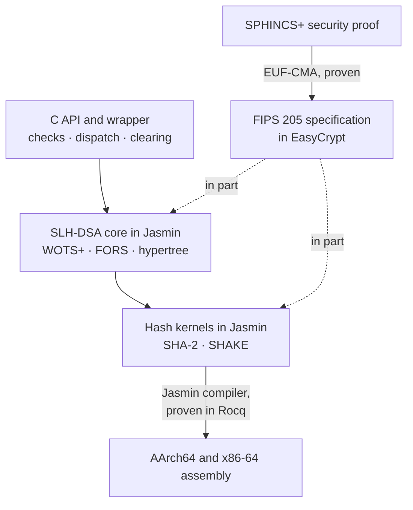

<div align="center">

# nirapod-slhdsa

SLH-DSA (FIPS 205) in [Jasmin](https://github.com/jasmin-lang/jasmin) for AArch64 and x86-64, with proofs in [EasyCrypt](https://github.com/EasyCrypt/easycrypt)

[](https://github.com/nirapod-labs/nirapod-slhdsa/actions/workflows/ci.yml) [](LICENSE)

</div>

> [!WARNING]
> **Under development. Not for production use.** All twelve parameter sets pass the NIST
> ACVP vectors on three platforms, but memory safety has not been checked and the proof
> that the code implements FIPS 205 is open. No release has been made.

## Where it stands

<!-- begin status:summary (rendered from docs/status.toml by ci/status.py; edit that file) -->
| Claim | Status | Scope |
| :-- | :-: | :-- |
| [Conformance to FIPS 205](docs/VALIDATION.md) | **VERIFIED**<br>PASS | ACVP vectors and a differential test, 12 sets, every interface, 3 platforms |
| [Constant time and speculative constant time](docs/SECURITY-MODEL.md) | **VERIFIED**<br>PASS | every Jasmin unit, both architectures; conditional on memory safety |
| [Memory safety of the Jasmin code](docs/SECURITY-MODEL.md#memory-safety) | **UNKNOWN**<br>NOT RUN | the checker reaches no verdict on these exports yet |
| [EUF-CMA security of the specification](docs/PROOFS.md#security-of-the-specification) | **PROVEN**<br>PASS | the EasyCrypt specification, 12 sets; not the Jasmin code |
| [The code implements the specification](docs/PROOFS.md#the-code-against-the-specification) | **UNKNOWN** | open; proven: portable SHA-2 kernels and hashes, HMAC steps and MGF1 over them, scalar Keccak-f[1600], single-way Keccak sponge absorb, finalize and squeeze, one-shot SHA-3 and SHAKE, address setters; on the scalar-variant models of both architectures, 12 sets: internal and external key generation, signing and verification (Algorithms 18 to 25) with every hash they call, for a message within the FIPS 180-4 length domain; not the SIMD and extension kernels, the C layer or entropy |
| [The compiler preserves program semantics](docs/TOOLCHAIN.md#assurance-boundary-of-the-toolchain) | **PROVEN**<br>PASS | source to assembly syntax, in Rocq; printer, assembler, linker trusted |

Results of CI run [38680243373](https://github.com/nirapod-labs/nirapod-slhdsa/actions/runs/38680243373) at `de27e6a`, 2026-10-15. Row *The compiler preserves program semantics*: run [38554446843](https://github.com/nirapod-labs/nirapod-slhdsa/actions/runs/38554446843) at `8646299`. Every set, interface and platform: [`docs/STATUS.md`](docs/STATUS.md).
<!-- end status:summary -->

The library picks a hash variant per call from the CPU's features, and only the
scalar variants are covered by the correctness proofs:
[which variant a CPU runs, and whether it is proven](docs/PROOFS.md#which-variant-a-cpu-runs).

## Quick start

Supported platforms are Linux on x86-64, Linux on AArch64 and macOS on AArch64;
nothing else is supported ([API](docs/API.md#supported-platforms)).

The repository carries the generated assembly of every target in `gen/`, so a C
compiler, the platform's assembler and linker, and Python 3 for the tests are
enough:

```sh
make                           # build/<target>/lib/libnirapod_slhdsa.a
make check                     # the tests of this host
```

To work on the Jasmin sources, the form to modify, build the pinned toolchain once
and pass the compiler; `make gen` then rewrites `gen/` from the sources. The
toolchain build checks the compiler's proofs and takes a while;
[`docs/TOOLCHAIN.md`](docs/TOOLCHAIN.md) lists what the host needs.

```sh
JOBS=4 toolchain/build.sh
export PATH="$PWD/toolchain/work/bin:$PATH"
make JASMINC=jasminc           # compile the Jasmin sources
make check JASMINC=jasminc     # also the tests that compile units of their own
make gen JASMINC=jasminc       # regenerate gen/ after a change to the sources
```

Sign and verify with one parameter set:

```c
#include <stdio.h>
#include "nirapod_slhdsa.h"

int main(void)
{
    const nirapod_slhdsa_set set = NIRAPOD_SLHDSA_SHAKE_128F;
    static uint8_t pk[NIRAPOD_SLHDSA_SHAKE_128F_PUBLIC_KEY_BYTES];
    static uint8_t sk[NIRAPOD_SLHDSA_SHAKE_128F_SECRET_KEY_BYTES];
    static uint8_t sig[NIRAPOD_SLHDSA_SHAKE_128F_SIGNATURE_BYTES];
    static const uint8_t msg[] = "hello", ctx[] = "example v1";

    if (nirapod_slhdsa_keygen(set, pk, sizeof pk, sk, sizeof sk) != NIRAPOD_SLHDSA_OK
        || nirapod_slhdsa_sign(set, sig, sizeof sig, msg, sizeof msg - 1,
                               ctx, sizeof ctx - 1, sk, sizeof sk) != NIRAPOD_SLHDSA_OK)
        return 1;
    int ok = nirapod_slhdsa_verify(set, sig, sizeof sig, msg, sizeof msg - 1,
                                   ctx, sizeof ctx - 1, pk, sizeof pk) == NIRAPOD_SLHDSA_OK;
    puts(ok ? "valid" : "invalid");
    return ok ? 0 : 1;
}
```

```sh
cc -Iinclude example.c build/<target>/lib/libnirapod_slhdsa.a -o example && ./example
```

Every call returns a status that must be checked. Keeping the secret key private, and
clearing it when done, is the caller's part; [`docs/API.md`](docs/API.md) has the full
contract.

## How it fits together



Solid arrows are calls, compilation and proven results; dotted arrows are proofs
that the code meets the specification, partial for the core (its scalar variant)
and for the hash kernels. Each parameter set is compiled once per hash variant, and the C
wrapper picks the variant the CPU supports at each call.
[`docs/ARCHITECTURE.md`](docs/ARCHITECTURE.md) walks through the layers.

## Documentation

| Page | Read it for |
| :-- | :-- |
| [API](docs/API.md) | calling the library: sizes, status codes, failure behaviour, stack use, clearing |
| [Architecture](docs/ARCHITECTURE.md) | layers, compilation units, variant dispatch, hash kernels |
| [Security model](docs/SECURITY-MODEL.md) | what is protected against which observer, faults, physical channels |
| [Validation](docs/VALIDATION.md) | ACVP, differential, negative and ABI tests, and where each runs |
| [Proofs](docs/PROOFS.md) | what is proven, about which code, under which assumptions |
| [Status](docs/STATUS.md) | every result per parameter set, interface and platform |
| [Declassification](docs/DECLASSIFICATION.md) | each secret-derived value the code releases, and why |
| [Toolchain](docs/TOOLCHAIN.md) | the pinned compiler and provers, building them, their trusted base |
| [Benchmarks](docs/BENCHMARKS.md) | how latency, throughput, stack depth and code size are measured and compared |

<details>
<summary><b>Repository layout</b></summary>

```text
include/        the C API, nirapod_slhdsa.h
capi/           the C wrapper: argument checks, dispatch, entropy, DIT, clearing
src/slhdsa/     FIPS 205 in Jasmin, one compilation unit per parameter set
src/hash/       SHA-2, SHA-3, SHAKE, HMAC and MGF1 in Jasmin, with their kernels
tests/          functional, ACVP, differential, negative, ABI and hash tests
analysis/       constant-time analysis and emitted-code policy
proofs/         EasyCrypt specification, security and correctness proofs
third_party/    imported EasyCrypt developments, with their provenance
bench/          benchmark harness, and the pins of the baselines it and the tests use
toolchain/      pinned Jasmin and EasyCrypt, the patch series, build.sh
ci/             CI checks and release tooling
changes/        one entry per change, collected at release
docs/           the pages above, and the status record docs/status.toml
```

</details>

## Security

Report a vulnerability privately, as [`SECURITY.md`](SECURITY.md) describes.

## License

Apache-2.0; see [`LICENSE`](LICENSE) and [`NOTICE`](NOTICE).
